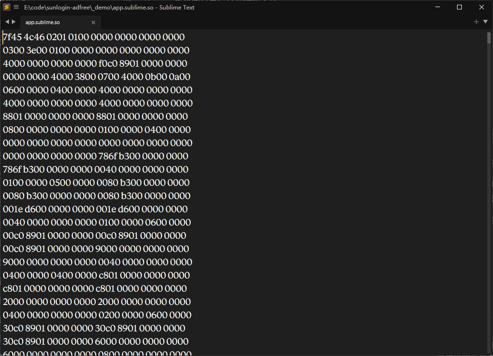
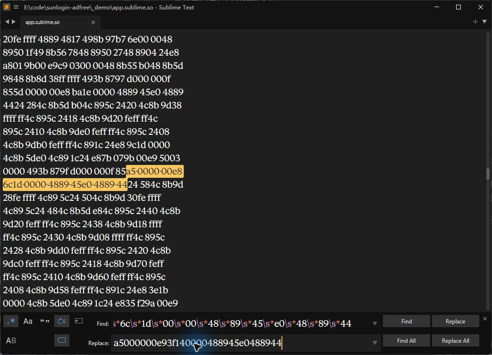
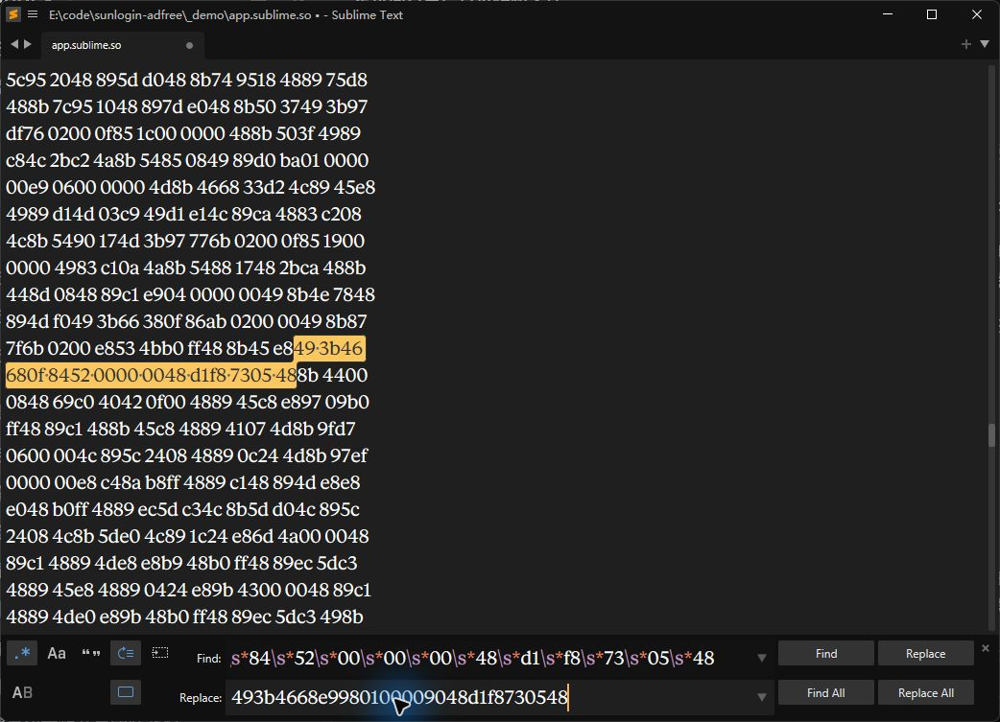
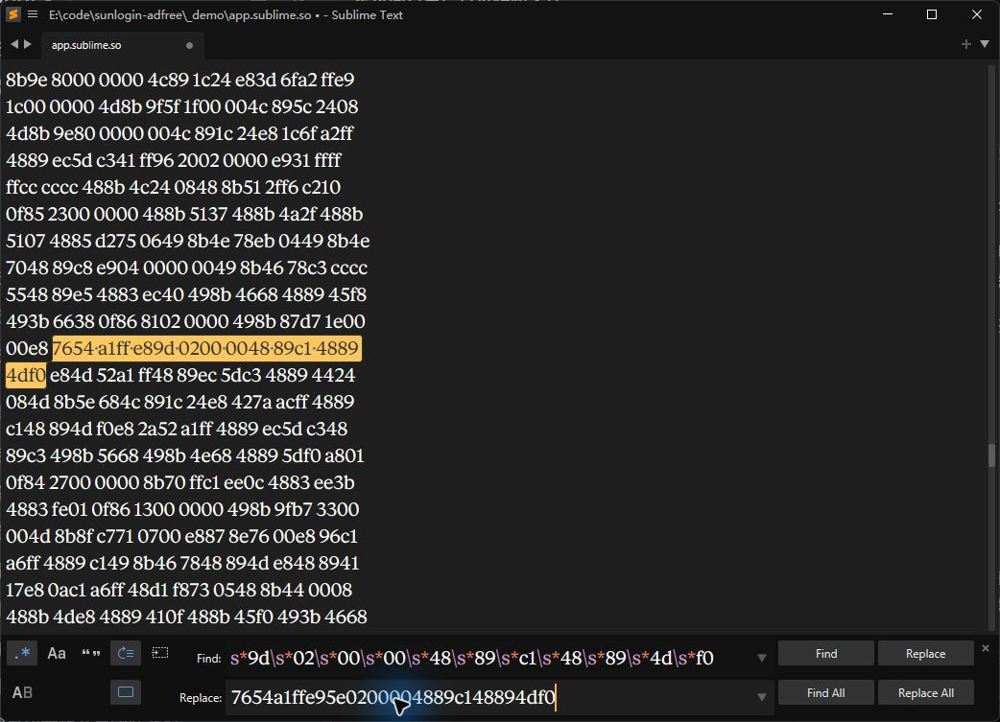

# sunlogin-adfree · 向日葵去广告

- **广告窗口：跳过创建，直接返回。**
- **广告内容：返回空内容。**
- **红包提醒：返回“不显示”。**

适用版本：**向日葵 Windows x64 16.5.0.30905**。演示使用 Sublime Text 4215。

## 方法一：直接替换

1. 退出向日葵界面，备份安装目录下的 `flutter\data\app.so`。
2. 从本仓库 [Releases](https://github.com/F7Pme/sunlogin-adfree/releases/latest) 下载修改好的 `app.so`，或下载 ZIP 后解压，覆盖原文件。
3. 重新启动向日葵。需要恢复时，把备份放回原位置。

## 方法二：用 Sublime 自己改

### 1. 打开文件

把 `flutter\data\app.so` 复制出来，用 Sublime 新窗口打开副本，保持 **Hexadecimal（十六进制）** 模式。



### 2. 查找替换

按 **Ctrl + H**，开启左侧 **`.*` 正则模式**。依次填入下面三组内容，点击 **Find** 定位，再点击 **Replace**，每组替换一次。

**① 广告窗口**

查找：

```regex
(?i)a5\s*00\s*00\s*00\s*e8\s*6c\s*1d\s*00\s*00\s*48\s*89\s*45\s*e0\s*48\s*89\s*44
```

替换：

```text
a5000000e93f140000488945e0488944
```



**② 广告内容**

查找：

```regex
(?i)49\s*3b\s*46\s*68\s*0f\s*84\s*52\s*00\s*00\s*00\s*48\s*d1\s*f8\s*73\s*05\s*48
```

替换：

```text
493b4668e9980100009048d1f8730548
```



**③ 红包提醒**

查找：

```regex
(?i)76\s*54\s*a1\s*ff\s*e8\s*9d\s*02\s*00\s*00\s*48\s*89\s*c1\s*48\s*89\s*4d\s*f0
```

替换：

```text
7654a1ffe95e0200004889c148894df0
```



### 3. 保存替换

按 **Ctrl + S** 保存，把修改后的副本命名为 `app.so`。退出向日葵界面，备份原文件后覆盖 `flutter\data\app.so`，重新启动即可。

## 定位与原理

`app.so` 包含编译后的 Flutter/Dart 界面代码。分析 AOT 反汇编，沿广告窗口模型 `AswAdWindowModel`、广告数据入口和续费弹层判断，定位到三处：

| 函数 | 文件偏移 | 修改作用 |
|---|---|---|
| `AWBadgeCreateManager.createSubWindow` 的广告分支 | `0xC933BF` | 跳过广告窗口创建，走已有空返回路径 |
| `AdDataTool.getAdInfo` | `0x103FF41` | 跳到空内容返回路径 |
| `TopBarRenewPopoverUtils.shouldShowRenewPopover` | `0x112F616` | 跳到 `false` 返回路径，不显示红包提醒 |

把对应调用或条件跳转改为 **JMP 无条件跳转**，沿用原有异步返回流程。三处都是等长替换，实际改变 9 个字节值；远控程序、DLL 和远控配置不作修改。

## 关闭自动更新

**设置 → 常规 → 软件更新 → 更新提醒**，取消 **Beta 版推送**，避免自动升级覆盖补丁。
